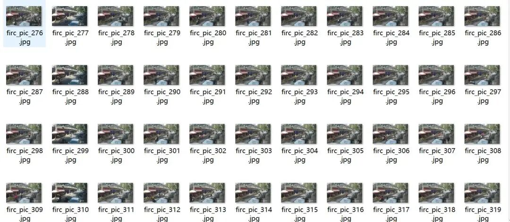
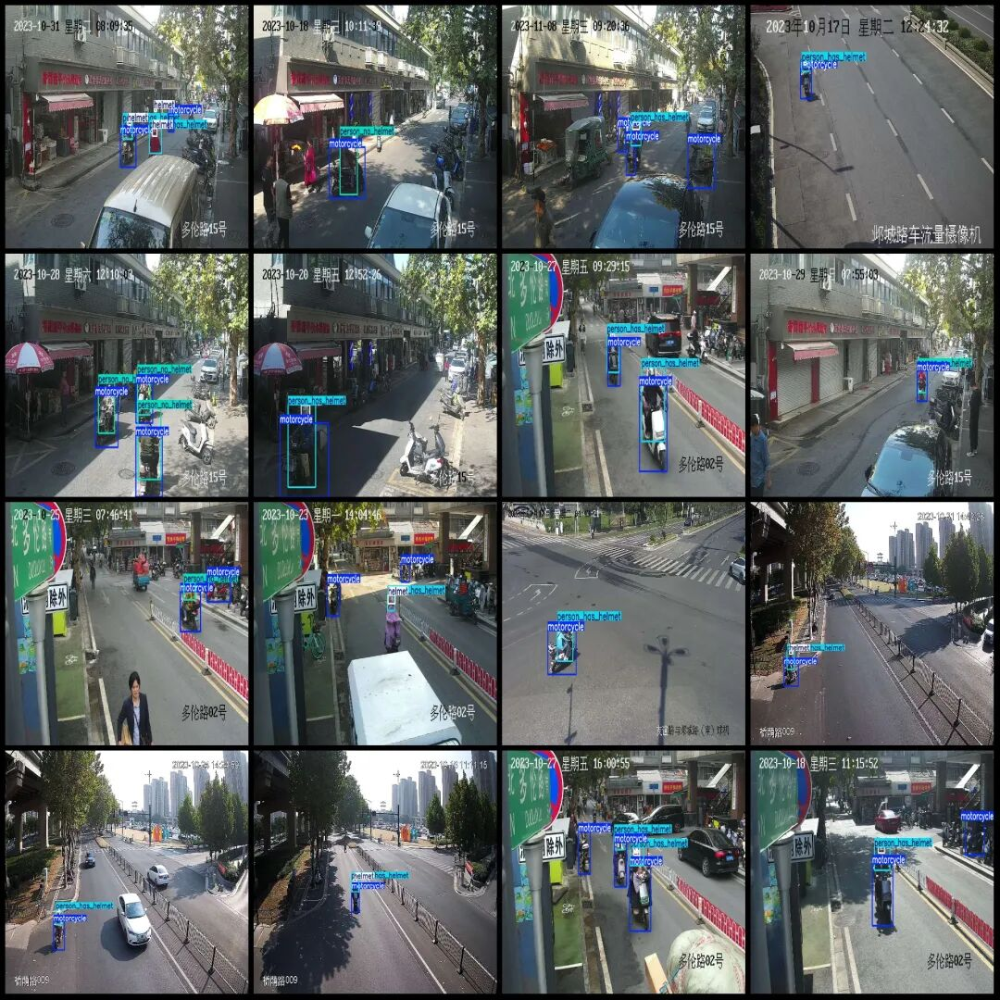
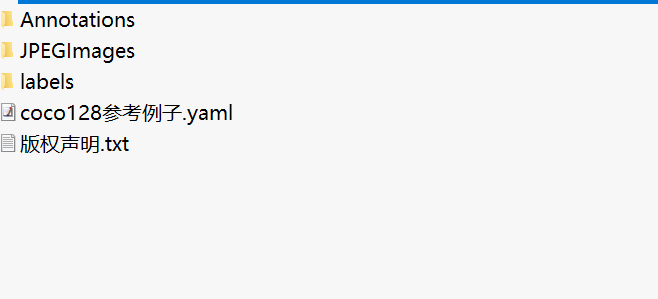
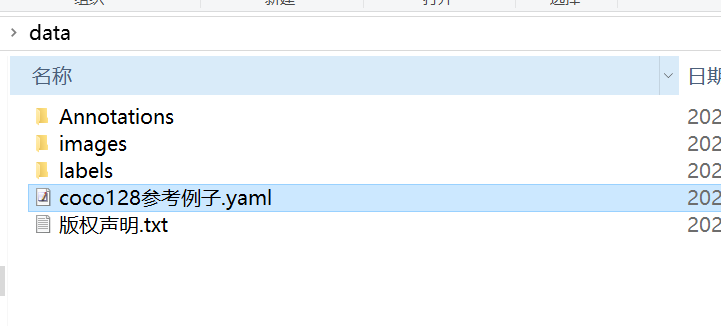
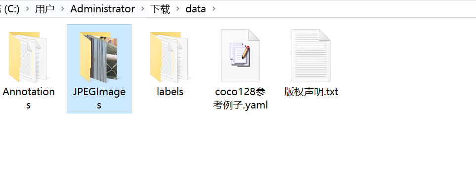
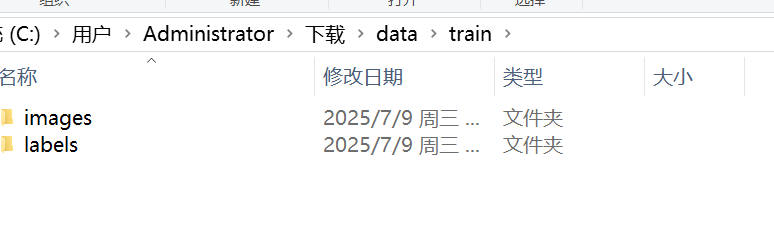
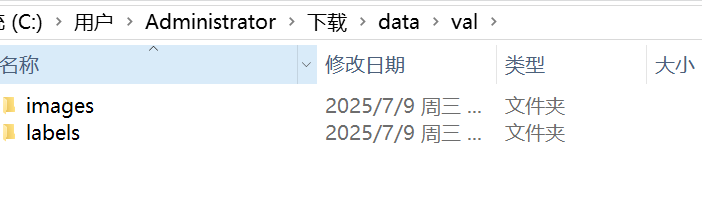
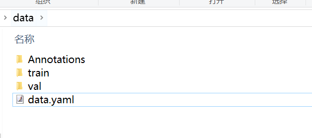
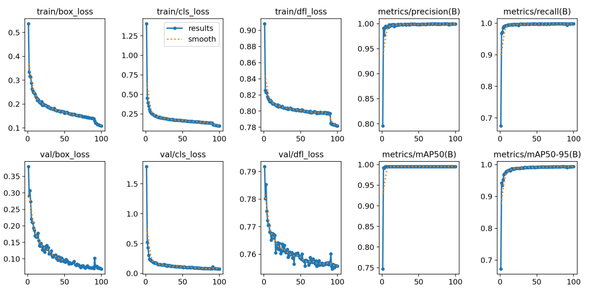

# Training a Dataset for Non-Motorized Electric Bike Helmet Wear Detection Using the Deep Learning Framework YOLOv8 in a VOC+YOLO format with 11,999 images across 4 categories and steps

[Dataset Introduction]

Dataset format: Pascal VOC format + YOLO format (txt file without split path, only containing jpg images and corresponding VOC format xml files and yolo format txt files)

Number of images (number of jpg files): 11999

Number of annotations (number of xml files): 11999

Number of annotations (number of txt files): 11999

Labeling category count: 4

Label category names (note that the order of yolo format categories does not correspond to this, but is based on the classes.txt in the labels folder): ["helmet", "motorcycle", "person_has_helmet", "person_no_helmet"]

Number of boxes labeled in each category:

Helmet frame count = 10385

Motorcycle frame count = 23145

person_has_helmet Frames = 10060

person_no_helmet Frames = 7557

Total frame count: 51147

Using labelImg:

Annotation rules: Draw a rectangle around the category.

Important Notice: No

Special : This dataset does not guarantee the accuracy or precision of the trained models or weight files. The dataset is provided with accurate and reasonable annotations only.

Image Preview:



Editor

Annotation example:



Editor

[Training Steps]

Firstly, take a screenshot of the dataset after acquisition:

 Edit

Compress the dataset package into a non-Chinese and space-separated path, such as C:\Users\Administrator\Downloads. Since we are using the YOLO training dataset, the Annotations folder is not needed; it can be left aside.

 Edit

The directory after unzipping is:

 Edit

Create two folders, train and val, under the data folder. Then, within each of these folders, create an images folder and a labels folder, as shown in the figure below.

 Edit

 Edit

Move the first 100 images and their corresponding annotations from the JPEGImages folder to the corresponding directories in the val folder. You can also choose to move or copy a specified number of images or annotations as needed. Finally, copy the remaining images and annotations txt files to the designated directory in the train folder.

Create your own training configuration file based on the coco128.yaml configuration, if there is no yaml file, you can write the configuration file in the following format:

```
train: C:\Users\Administrator\Downloads\data\train\images
val: C:\Users\Administrator\Downloads\data\val\images
nc: 4
names:
0: helmet
1: motorcycle
2: person_has_helmet
3: person_no_helmet
```

After writing, here I call it data.yaml. Note that the categories above must be consistent with the classes.txt in the labels folder.

 Edit

Afterwards, it's time to start training. Note that you need to have your Yolov8 model environment set up beforehand for training.

Start training with a pre-trained model.

yolo task=detect mode=train model=yolov8n.pt data=data.yaml epochs=100 imgsz=640 batch=8

Parameters Description:

Model: The type of model used, such as yolov8s.pt (small model), yolov8m.pt (medium), yolov8l.pt (large)
Data: The specified data configuration file
Epochs: Number of training rounds
Imgsz: Input image size
Batch: Batch size (adjusted according to memory capacity)
After training, the best weights are saved at the path: runs/detect/train/weights/best.pt. If multiple runs are executed, the directories runs/detect/train2 and runs/detect/train3 will be created. Only go to the directory with the highest number to find the model.

Image prediction:

```
from ultralytics import YOLO
# Load the trained model
model = YOLO('runs/detect/train/weights/best.pt')
# Image Prediction
results = model('path_to_your_image.jpg')

```

Video or camera prediction

```
results = model('path_to_video.mp4') # video
#results = model(0) # Camera

```

Validation set evaluation

```
yolo task=detect mode=val model=runs/detect/train/weights/best.pt data=data.yaml

```

Output the indicator image, usually generated after model training, located at runs/detect/train/results.png:

 Edit

Introduction to commonly used evaluation parameters in the above training results images.

In the task of object detection, evaluating the performance of a model is crucial. The terms you mentioned are commonly used metrics for assessing model performance. Here are detailed explanations of these terms:

Class:
This typically refers to the categories of objects that the model is designed to detect. For example, a model might be trained to detect vehicles, pedestrians, or animals among different categories.
Images:
Represents the number of images in the validation set. The validation set is used to evaluate the performance of the model and is separate from the training set to ensure fairness in evaluation results.
Instances:
Total number of target objects in all images. This includes the sum of all category objects, for example, if the validation set contains 100 images, with an average of 5 target objects per image, then Instances would be 500.
P (Precision):
Precision is the ratio of true positives (TP) to the sum of true positives and false positives (FP). The formula is Precision = TP / (TP + FP), where TP represents true positives and FP represents false positives.
R (Recall):
Recall is the ratio of true positives to the sum of true positives and false negatives (FN). The formula is Recall = TP / (TP + FN), where FN represents false negatives.
mAP50:
Represents the mean average precision (mAP) at IoU threshold of 0.5. IoU is an indicator measuring the overlap degree between predicted bounding boxes and ground truth bounding boxes. mAP is a comprehensive metric that considers both precision and recall, used to evaluate the performance of models at different recall levels. At IoU=0.5, if the overlap between predicted and ground truth bounding boxes reaches or exceeds 50%, it is considered correct.
mAP50-95:
This represents the average accuracy of the model across a range of IoU values from 0.5 to 0.95 (with an interval of 0.05). This is a more stringent evaluation criterion, demanding higher overlap between predicted bounding boxes and true ones. In object detection tasks, a higher IoU threshold implies that models need to be more accurate in target object localization. The calculation of mAP50-95 takes into account multiple IoU thresholds ranging from lenient to strict, thus providing a comprehensive assessment of model performance.
These metrics collectively form an important framework for evaluating the performance of object detection models. By comparing the performance of different models on these metrics, one can determine which model may be more effective in practical applications.

Export the model to ONNX, TensorRT, etc. for deployment:

yolo export model=runs/detect/train/weights/best.pt format=onnx
Supported formats include: onnx, engine, tflite, pb, torchscript, etc.

After the above training, models can be deployed for one step. For example, use an Onnx model for embedded deployment, use an engine model for DeepStream deployment on Jetson, and use a torchscript model for deployment on C++, etc.


## Payment

Here is a pay link on Stripe ( https://buy.stripe.com/3cs8yP7sY87d0vu9AB ). Please contact me lonlonago@foxmail.com after funding $89, and I will send you a complete data files , thank you!


